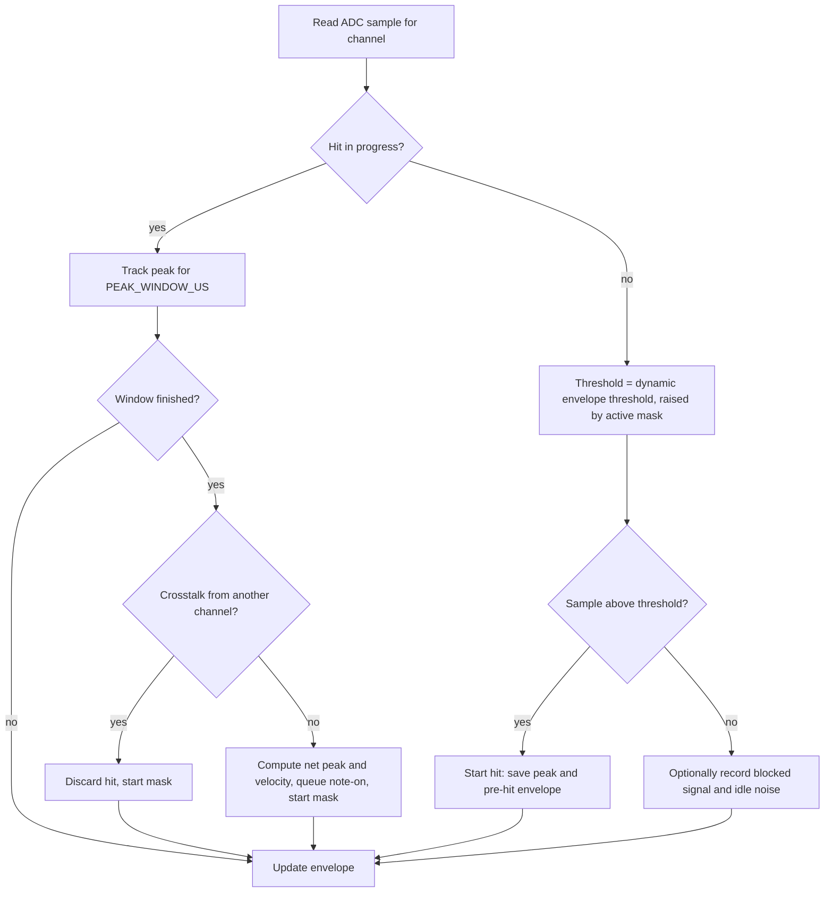

# ESP32-S3 USB-MIDI Piezo Drum Trigger

An Arduino sketch that turns an ESP32-S3 and one or two MCP3008 ADC chips into a USB-MIDI drum trigger module with up to 16 piezo inputs. It is designed to handle hard hits, soft ghost notes, buzz rolls and flams while avoiding the multiple note-ons that piezo ringing, rubber-pad rebound and plate vibration normally cause.

> **Defaults in this document** are the values in the current sketch. They were tuned on one specific setup (a rubber pad on a metal plate on foam, 3.3 V ADC range). Different pads, foam and piezo mounting will change the numbers, which is why a calibration procedure is included below.

---

## Table of contents

1. [Features](#features)
2. [Hardware](#hardware)
3. [Arduino IDE setup](#arduino-ide-setup)
4. [How it works](#how-it-works)
5. [Serial output and how to read it](#serial-output-and-how-to-read-it)
6. [Parameter reference](#parameter-reference)
7. [Calibration guide](#calibration-guide)
8. [Troubleshooting quick reference](#troubleshooting-quick-reference)
9. [Limitations and notes](#limitations-and-notes)

---

## Features

- Up to **16 piezo inputs** (two MCP3008 chips, 8 channels each) sent as **USB-MIDI** notes on MIDI channel 10 (percussion).
- **Per-channel dynamic threshold.** An envelope follower tracks each channel's recent signal level and keeps the trigger threshold just above it, so ringing from a previous hit cannot re-trigger, but a real new strike (ghost note, buzz stroke) still can.
- **Hit-strength-scaled mask.** After a hit, a lockout whose length grows with the hit's strength blocks rebound and plate bounce. Soft hits get a very short mask so buzz rolls stay responsive.
- **Optional second mask tier** for very hard hits only, to block late bounce without blocking a comparably strong follow-up.
- **Pre-hit offset velocity compensation.** A hit that lands on top of a still-decaying hit is scaled by how far it rose above where the signal already was, not from 0 V.
- **Selectable velocity curves** (linear, S-curve, logarithmic, exponential, adjustable power) with a minimum velocity and adjustable low and high scaling points.
- **Crosstalk rejection** between channels.
- **Reduced-overhead ADC sampling:** each MCP3008 read is a single 3-byte SPI transfer with chip select toggled by a direct GPIO register write (no DMA), to maximise the scan rate and the number of samples captured per hit.
- **Thread-safe hit queue** between the scan task and MIDI sender, so back-to-back hits are never lost or overwritten.
- **Raw waveform capture:** records one channel's samples, envelope and threshold around a strike and prints them as CSV, so hits and flams can be analysed offline.
- **Diagnostics over serial:** per-hit lines, once-per-second report, per-channel idle noise levels, and "blocked hit" lines that show what rejected a hit-like signal.

---

## Hardware

### Wiring

Both MCP3008 chips share CLK, MISO and MOSI and have separate chip-select lines.

| ESP32-S3 pin | MCP3008 chip 1 | MCP3008 chip 2 |
| --- | --- | --- |
| GPIO 11 | CLK | CLK |
| GPIO 12 | DOUT (MISO) | DOUT (MISO) |
| GPIO 13 | DIN (MOSI) | DIN (MOSI) |
| GPIO 10 | /CS | n/a |
| GPIO 9 | n/a | /CS |
| 3.3 V | VDD, VREF | VDD, VREF |
| GND | AGND, DGND | AGND, DGND |

> The chip-select pins must be **GPIO 0 to 31**, because the sketch toggles them with a single GPIO register write for speed. GPIO 9 and 10 satisfy this. If you move them, keep them in that range.

### Piezo input conditioning

The sketch expects each piezo input to be conditioned in hardware so the ADC input stays within **0 to 3.3 V** (for example a voltage limiter / clamp). Readings are 10-bit (0 to 1023); with a 3.3 V reference, a raw value of 737 is about 2.38 V.

### Channel mapping

Channels are scanned chip 1 channel 0 to 7, then chip 2 channel 0 to 7. `CHANNELS_IN_USE` sets how many are scanned, and `drumNotes[]` maps each channel to a MIDI note using the names in `midi_percussion_notes.h`.

---

## Arduino IDE setup

Tested with Arduino IDE 2.3.8, ESP32 board package (Espressif) 3.3.8, and Adafruit TinyUSB Library 3.7.7.

In the Tools menu:

| Setting | Value |
| --- | --- |
| Board | ESP32S3 Dev Module |
| USB Mode | USB-OTG (TinyUSB) |
| Upload Mode | USB-OTG CDC (TinyUSB) |
| USB CDC On Boot | Enabled (to see serial over USB) or Disabled (serial on UART0 TX) |

Arduino requires the sketch to be in a folder with the same name, with `midi_percussion_notes.h` beside it:

```
Midi_Drum_Controller/
  Midi_Drum_Controller.ino
  midi_percussion_notes.h
```

Open the serial monitor at 115200 baud to see diagnostics. Your DAW or MIDI monitor will see a device named "ESP32-S3 Drum Trigger Module".

---

## How it works

Each channel is sampled continuously by a task pinned to core 1. The main loop sends MIDI and prints diagnostics, and sleeps one FreeRTOS tick (about 1 ms) at the end of every pass so that it never competes with the scan task for the CPU (see the note below).

**Sampling.** Every read is one 3-byte exchange with the MCP3008 sent in a single `transferBytes()` call, with chip select driven by a GPIO set/clear register write instead of `digitalWrite()`. The envelope decay uses a short series approximation of `exp(-x)` for the small per-sweep time step. The SPI clock runs at the MCP3008 maximum for 3.3 V (2.34 MHz) and the bus is not using DMA (DMA was tested on this project and was slower).

**The loop task must sleep.** The Arduino `loop()` task and the scan task run on the same core at the same priority. If `loop()` never blocks, FreeRTOS time-slices them one tick each. Debug captures during ADC sampling originally showed a sampling inactivity gap of about 1.1 ms, repeating every 2 ms, so the ADC was being sampled less than half of the time expected. Adding `vTaskDelay(1)` at the end of `loop()` removes the gaps. The report line `Longest Gap Between Sweeps` shows whether the scan task is still being interrupted: it should stay close to the sweep time. Occasional larger values in a second that also printed hits or a capture are normal, because serial output runs in the loop task.

After improving the scan rate by removing sampling inactivity gaps, when scanning 8 channels, each channel was sampling at around 8400 Hz (numbers appear in the once-per-second serial debug report).  The rate per channel will change as more or less channels are enabled for scanning.



### 1. Envelope and dynamic threshold

Each channel keeps an **envelope**: it jumps instantly to any higher sample, is held for `ENV_HOLD_US`, then decays exponentially with time constant `ENV_DECAY_TAU_US`. The trigger threshold is always just above it:

```
threshold = max(MIN_THRESHOLD, envelope * (1 + RETRIG_RATIO) + RETRIG_ABS_MARGIN)
```

Ringing from a previous hit stays under its own envelope, so it cannot re-trigger. A new strike rises above the decaying envelope and is detected, even while the old hit is still fading.

### 2. Peak window

When a sample first crosses the threshold, the sketch collects the highest sample seen over `PEAK_WINDOW_US` and uses that as the hit's peak. Two strikes closer together than this window merge into one hit. A longer window also gives a slow-rising rubber pad some time to reach its true peak, so the first note's velocity is not underestimated.  A window of 3000 μS was a good compromise on the test drum pad.  2000 caused chains of false triggered notes and 5000 started impacting the lightest registered velocity. The window is also the delay between the strike and the note being sent, and strikes closer than the window will merge.

### 2b. Same-strike guard

A pad's plate rings as a half-wave rectified signal with humps about 5 ms apart, and the second hump may sometimes be larger than the first. If the first note has already been sent, that second hump could look like a new strike. `MIN_RETRIGGER_US` (default 8000) rejects any new trigger that starts within that time of the *start* of the previous strike. It only affects strokes closer than 8 ms, which are indistinguishable from the test pad's own ring.  Real fast hits like flams and buzz-roll strokes should fall outside that time window and not be impacted. Set it to 0 to disable it. Rejections show in the serial debug output as `SAMESTRIKE` in the blocked lines and as flag 64 in captures.

### 3. Hit-strength-scaled mask

After a hit is reported, the channel is masked for a time that scales with the hit's peak, from `MASK_MIN_US` (soft hit) to `MASK_MAX_US` (hardest hit). While masked, a new trigger must also exceed a multiple of the previous hit's peak. That multiple **starts at `MASK_OVERRIDE_RATIO` right after the hit and relaxes linearly to `MASK_OVERRIDE_RATIO_END` by the end of the mask.** Ring is strongest immediately after a hit and fades, so the strong early ring stays blocked while a similar-strength second stroke later in the mask (for example 20 ms into a flam) can pass. A louder follow-up always passes. Setting the two values equal gives a fixed ratio.

### 4. Optional second mask tier

For hits with a raw peak of at least `MASK2_MIN_PEAK`, a second window follows the main mask, scaling from 0 up to `MASK2_MAX_US` at `MAX_THRESHOLD`. During it, a new trigger must exceed `MASK2_RATIO` times the previous peak. This blocks late bounce after very hard hits while allowing a strong follow-up. Medium and soft hits never get a second tier. Set `MASK2_ENABLED` to 0 to disable it completely.

### 5. Pre-hit offset and velocity

The envelope value just before a trigger is saved as the pre-hit offset. Velocity is computed from:

```
net = peak - PRE_HIT_OFFSET_WEIGHT * preHit
```

`net` is then mapped through the selected curve from `VEL_SCALE_LOW_PEAK` (velocity `MIN_VELOCITY`) up to `MAX_THRESHOLD` (velocity 127).

### 6. Crosstalk rejection

If another channel triggered within `X_TALK_WINDOW_US` and this channel's peak is below `X_TALK_RATIO` times that channel's peak, the hit is treated as pickup and discarded.

### 7. MIDI output

Note-ons are sent on MIDI channel 10 with the computed velocity. A note-off follows 25 ms later (fixed in `loop()`); an earlier note-off is sent first if the same note is retriggered while still on.

---

## Serial output and how to read it

### Per-hit lines (`DEBUG_HITS`)

```
HIT ch 1 | peak  737 | pre    1 | net  736 | vel 127 | gap  6749 ms
```

| Field | Meaning |
| --- | --- |
| `peak` | Highest ADC sample in the peak window (0 to 1023) |
| `pre` | Envelope level just before the hit |
| `net` | Peak minus `PRE_HIT_OFFSET_WEIGHT` times pre; the value that is scaled to velocity |
| `vel` | MIDI velocity sent |
| `gap` | Milliseconds since the previous reported hit on this channel (65535 = none yet or very long ago) |

### Blocked-hit lines (`DEBUG_BLOCKED`)

```
BLOCKED ch 1 EARLY | peak  288 | needed  405 ( 71%) | by SAMESTRIKE | last hit peak  410 |    5 ms after hit
BLOCKED ch 1 LATE  | peak  288 | needed  405 ( 71%) | by MASK1      | last hit peak  410 |   21 ms after hit
```

For each hit, the strongest rejected signal is printed once per band over the next `BLOCK_EPISODE_US`. `EARLY` means it came within `MIN_RETRIGGER_US` of the strike start (ring of the same strike); `LATE` means later, where a genuine second stroke such as a flam would appear. Read the `LATE` lines when tuning flams and rolls.

| Field | Meaning |
| --- | --- |
| `peak` | Strongest rejected sample |
| `needed` | Threshold it had to beat at that moment, with the percentage it reached |
| `by` | `ENVELOPE` (decaying envelope threshold), `MASK1` (main mask), `MASK2` (second tier) or `SAMESTRIKE` (same-strike guard) |
| `last hit peak` | Peak of the previous reported hit |
| `ms after hit` | Time between the previous hit and the blocked sample |

Rebound and ring after hard hits will also appear here, usually at low percentages and long delays. A genuine second stroke (a flam, for example) typically shows a high percentage and a short delay.

### Once-per-second report (`SHOW_SECOND_REPORT`)

Shows scans per second, sweep timing, per-channel hit counts and peaks, and (with `SHOW_IDLE_NOISE`) **idle noise** per channel:

```
-> CH  6 | Noise Max:  15 | Noise Mean:   1.4 | Samples: 3348
```

Idle noise only counts quiet samples taken at least `NOISE_SETTLE_US` after the last hit.

---

## Raw waveform capture

The peak, `pre` and `BLOCKED` numbers only describe a hit's level. To see what a hit or a flam actually *looks like*, for example to find out whether a second flam stroke has a different shape from the ring of the first, the sketch can record one channel's raw samples and serial print them as CSV.

**How it works.** The selected channel's samples are kept in a rolling buffer together with the envelope and threshold the sketch was using at that moment. When a *fresh* strike arrives (the channel was quiet before it), the sketch keeps recording for `CAPTURE_POST_MS` so a flam's second stroke is inside the recording, then prints it. Printing is done in small pieces from the main loop and never blocks MIDI; the once-per-second report waits until printing is finished. Triggering and MIDI are not affected.

**Using it.**

1. Set `CAPTURE_MODE` to 1 and `CAPTURE_CHANNEL` to the channel you are testing.
2. Play one or more hits to be captured, then wait for the capture data to appear in the serial output.
3. To use the captured data, copy everything in the serial monitor output from `CAP_BEGIN` to `CAP_END` and put it into a text file or spreadsheet for analysis.  There may be other debug text lines within the capture data starting with `HIT` and `BLOCKED` since they are still printed normally, and they can be removed or ignored when plotting.

**Output format.**

```
CAP_BEGIN ch=1 samples=358 pre_ms=5 post_ms=80
CAP_COLS t_us,raw,env,thr,flags
CAP,-5012,0,0,0
...
CAP,0,57,12,33
CAP_END
```

| Column | Meaning |
| --- | --- |
| `t_us` | Microseconds relative to the trigger sample (negative = before) |
| `raw` | The ADC sample |
| `env` | The envelope value after this sample |
| `thr` | The threshold applied to this sample (0 while a hit's peak window is open) |
| `flags` | Event markers, added together: 1 = trigger started, 2 = note sent, 4 = main mask active, 8 = second tier active, 16 = rejected as crosstalk, 32 = fresh strike, 64 = rejected by the same-strike guard |

Plot `raw`, `env` and `thr` against `t_us`. Some things to look for: whether the second stroke of a flam shows a dip followed by a sharp rise, while plate ring decays smoothly; the interval between ring peaks; and how long a hard hit's ring stays near 90% of its first peak.

---

## Parameter reference

All parameters are `#define` or `const` values at the top of the sketch. "Default" is the value used with the test drum pad.

### Hardware and scanning

| Parameter | Default | What it does | When to change |
| --- | --- | --- | --- |
| `CHANNELS_IN_USE` | 8 | Number of ADC channels scanned (1 to 16) | Set to the number of pads actually wired. Fewer channels means a faster scan rate, more samples per hit and better peak capture. |
| `SPI_CLK_SPEED` | 2340000 | SPI clock in Hz | MCP3008 maximum is 2.34 MHz at 3.3 V (3.6 MHz at 5 V) |
| `ADC_VREF` | 3.3 | Reference voltage, only used for the printed voltage | Match your hardware |
| `MIDI_CHANNEL` | 10 | MIDI channel for notes | Leave at 10 for percussion |
| `drumNotes[]` | see sketch | MIDI note per ADC channel | Change to suit your drum mapping |

### Trigger detection

| Parameter | Default | What it does | How to adjust |
| --- | --- | --- | --- |
| `MIN_THRESHOLD` | 30 | Lowest ADC level that can start a hit | Set to about 2 times the worst idle noise max. Lower for more sensitivity, raise if false triggers appear. |
| `MAX_THRESHOLD` | 700 | Net peak that maps to velocity 127 | Set just above the hardest hit you actually play (check the `peak` values of hard hits). |
| `PEAK_WINDOW_US` | 3000 | How long the peak is collected after a trigger; also the delay before the note is sent | Raise if one strike produces a chain of notes 2 to 3 ms apart with rising peaks (the window is closing before the strike has finished rising). 3000 worked best on the test drum pad (2000 caused extra hits; 5000 raised the lightest velocity to be at higher levels). |
| `MIN_RETRIGGER_US` | 8000 | Rejects a trigger starting within this time of the previous strike's start (ring humps) | Lower (for example 5000) or set 0 if very fast press-roll strokes are being merged; raise if doubles 3 to 5 ms after a strike appear. |
| `X_TALK_WINDOW_US` | 2000 | Time window for comparing against other channels' hits | Rarely needs changing |
| `X_TALK_RATIO` | 0.25 | A hit below this fraction of a neighbour's recent peak is discarded as pickup | Raise if a neighbouring pad falsely triggers; lower if real hits near a hard hit on another pad get dropped |

### Envelope and dynamic threshold

| Parameter | Default | What it does | How to adjust |
| --- | --- | --- | --- |
| `ENV_HOLD_US` | 3000 | Time the envelope stays at its peak before decaying | Raise if low-frequency ringing (such as a kick) retriggers between its peaks |
| `ENV_DECAY_TAU_US` | 12000 | Envelope decay time constant | **Smaller** = easier buzz rolls and ghost notes. **Larger** = better double-trigger rejection, but quiet strokes after medium hits can be missed. |
| `RETRIG_RATIO` | 0.08 | Fraction above the envelope the threshold sits | Raise to be stricter, lower to be more sensitive |
| `RETRIG_ABS_MARGIN` | 12 | Extra ADC counts above the envelope | Same as above, matters more at low levels |

### Mask (rebound guard)

| Parameter | Default | What it does | How to adjust |
| --- | --- | --- | --- |
| `MASK_MIN_US` | 3000 | Mask length after a very soft hit | Usually leave alone |
| `MASK_MAX_US` | 40000 | Mask length after the hardest hit; scales with hit strength | Raise if hard hits still produce a second note-on. Lower to improve fast hard-hit rolls and flams. |
| `MASK_OVERRIDE_RATIO` | 0.95 | Multiple of the previous peak a new hit must exceed **right after a hit** (start of the mask) | Raise toward 1.0 to 1.1 if early ring leaks through as extra notes. Values around 0.7 to 0.8 right after a hit let plate ring through on the test drum pad. |
| `MASK_OVERRIDE_RATIO_END` | 0.80 | The same multiple at the **end of the main mask**; the ratio relaxes linearly between the two values | Lower to let similar-strength strokes through later in the mask (flams at 15 to 40 ms). Raise if late ring leaks through. Set equal to `MASK_OVERRIDE_RATIO` for a fixed ratio. |

### Second mask tier (optional)

| Parameter | Default | What it does | How to adjust |
| --- | --- | --- | --- |
| `MASK2_ENABLED` | 1 | 1 = on, 0 = off (identical to not having it) | Set to 0 if it gives no benefit |
| `MASK2_MIN_PEAK` | 400 | Hits below this raw peak get no second tier | Raise to protect more medium-hard hits from it |
| `MASK2_MAX_US` | 30000 | Extra window length for a full-strength hit | Raise if late bounce (50 to 100+ ms after a hard hit) still triggers |
| `MASK2_RATIO` | 0.5 | During the second tier, a new hit must exceed this fraction of the previous peak | Raise to block more late bounce, lower to allow more follow-up hits |

### Velocity scaling

| Parameter | Default | What it does | How to adjust |
| --- | --- | --- | --- |
| `PRE_HIT_OFFSET_WEIGHT` | 0.2 | 0 = ignore the signal level before the hit, 1 = subtract it fully | Lower if ghost notes after loud hits are too quiet or missing, raise if they are too loud |
| `VEL_SCALE_LOW_PEAK` | 170 | Net peak that maps to `MIN_VELOCITY` | Raise to make the softest hits quieter. Set it just under the raw peak of your lightest intended tap on the pad. |
| `MIN_VELOCITY` | 8 | Lowest velocity sent | Lower for quieter ghost notes |
| `ACTIVE_CURVE` | `CURVE_POWER` | Velocity curve: `CURVE_LINEAR`, `CURVE_SCURVE`, `CURVE_LOGARITHMIC`, `CURVE_EXPONENTIAL`, `CURVE_POWER` | Power is the adjustable one |
| `VELOCITY_CURVE_EXPONENT` | 1.2 | Exponent for `CURVE_POWER` | Above 1 makes soft hits quieter, below 1 boosts them |

### Diagnostics

| Parameter | Default | What it does |
| --- | --- | --- |
| `DEBUG_HITS` | 1 | Print one line per hit. Set to 0 if serial output ever delays timing on busy playing. |
| `SHOW_SECOND_REPORT` | 1 | Print the once-per-second report |
| `SHOW_IDLE_NOISE` | 1 | Include idle noise per channel in the report |
| `NOISE_SETTLE_US` | 150000 | A channel must be quiet this long before its samples count as idle noise |
| `DEBUG_BLOCKED` | 1 | Print blocked-hit lines |
| `DEBUG_BLOCKED_MIN_PEAK` | 80 | Ignore blocked signals below this level |
| `DEBUG_BLOCKED_MIN_RATIO` | 0.30 | Ignore blocked signals below this fraction of the previous hit's peak |
| `BLOCK_EPISODE_US` | 100000 | How long after a hit the strongest blocked signal is collected |
| `CAPTURE_MODE` | 0 | 1 = record raw waveforms of one channel and print them as CSV (see [Raw waveform capture](#raw-waveform-capture)); 0 = off, with no effect on anything else |
| `CAPTURE_CHANNEL` | 1 | ADC channel (0 to 15) to record |
| `CAPTURE_PRE_MS` | 5 | Milliseconds recorded before the trigger |
| `CAPTURE_POST_MS` | 80 | Milliseconds recorded after the trigger (long enough to include a flam's second stroke) |
| `CAPTURE_MAX_PREHIT` | 60 | A capture only starts when the channel's level before the strike was below this |
| `CAPTURE_BUF_SAMPLES` | 3000 | Buffer size in samples (12 bytes each); must cover pre plus post time at your scan rate |

---

## Calibration guide

All ADC channels share one calibration for now, so it is assumed all trigger input hardware and mechanical response is identical. Change **one setting at a time** and repeat a test to check results. Start from the defaults above.

> If you change the pad, foam, plate or piezo mounting, the ring and bounce behaviour changes. Repeat steps 3 onward after any hardware change.

### Step 0: Get a baseline

1. Flash the sketch with the default values and open the serial monitor to see debug reports.
2. Note the `Full-Kit Scans Per Second` value in the report. Check that `Longest Gap Between Sweeps` stays close to the sweep time: a higher rate with no long gaps means more samples inside the peak window and more accurate hit peaks.
3. If you only use a few pads, set `CHANNELS_IN_USE` to match that reduced number of inputs and allow faster scanning.
4. Confirm each pad sends the expected MIDI note in your DAW or MIDI monitor.

### Step 1: Measure idle noise and set the floor

1. Leave all pads untouched for a few seconds.
2. Read `Noise Max` for each channel.
3. Set `MIN_THRESHOLD` to roughly **2 times the highest noise max** you want to protect against (for example, a max of 15 gives a floor of about 30).

**Expect:** no hits, no `HIT` lines while idle. **If** you see phantom hits, raise `MIN_THRESHOLD`. **If** a channel is much noisier than the rest, check its wiring and grounding.

### Step 2: Find your velocity range

1. Play 10 or more of your **softest** deliberate hits and note the `peak` values.
2. Play 10 or more of your **hardest** hits and note the highest `peak` values.
3. Set `MAX_THRESHOLD` just above the hardest peaks.
4. Check the velocities of the soft hits in your DAW.

**Adjust:**
- Soft hits too loud: raise `VEL_SCALE_LOW_PEAK`, raise `VELOCITY_CURVE_EXPONENT` above 1.0, or lower `MIN_VELOCITY`.
- Soft hits too quiet or inconsistent: lower `VELOCITY_CURVE_EXPONENT` below 1.0, or check that `VEL_SCALE_LOW_PEAK` sits just below your lightest tap's raw ADC `peak` reading.
- Hard hits never reaching velocity 127: lower `MAX_THRESHOLD`.

### Step 3: Single hard hits (one hit, one note-on)

1. Play single hard hits, letting the pad ring naturally.
2. Expect **one `HIT` line** per strike.
3. If extra `HIT` lines appear, look at their `gap` and `peak`:
   - Gap of only about 2 to 3 ms, where each hit's `pre` equals the previous hit's peak and the peaks keep rising (for example 354, then 535, then 599): this is one strike that was still rising when the peak window closed. The first note also gets a velocity that is too low. Raise `PEAK_WINDOW_US` (the default of 3000 is already above the value that caused this) and/or reduce `CHANNELS_IN_USE` to raise the scan rate. A lower override ratio does not fix this.
   - Gap 15 to 70 ms with smaller, decaying peaks: stick rebound or plate ring. Raise `MASK_MAX_US` (for example 40000 to 60000), or enable and strengthen the second tier (`MASK2_ENABLED` 1, raise `MASK2_MAX_US` or `MASK2_RATIO`).
   - Test: hit hard and immediately press the stick into the pad. If the extra hit disappears, it was real stick rebound and not plate ring.

If the plate bounces a lot on its foam, a mechanical fix (denser foam, damping, more mass) is usually better than ever-longer masks.
**Note:**
If there are sometimes single registered hits and sometimes 2 or 3 registered hits each time a single hard hit is made, it may be tolerable if everything sounds and feels natural, and it may be the best result possible with that physical setup.

### Step 4: Medium hits and consistency

1. Play a pattern of 3 or 4 medium strokes with different strengths.
2. Expect every stroke to produce one note with a believable velocity, and none to be missed.

**If** strokes are missed or velocities seem random, `ENV_DECAY_TAU_US` may be too large (try 12000 or lower) or `MASK_MAX_US` too long for the strength involved.

### Step 5: Ghost notes and buzz rolls

1. Play a loud hit, then a quiet stroke 20 to 50 ms later, repeatedly.
2. Play fast, quiet buzz rolls.
3. Expect each stroke to produce a note, with quiet strokes registering hits at low velocity.

**Adjust:**
- Quiet strokes missed: lower `ENV_DECAY_TAU_US`, `RETRIG_RATIO` and `RETRIG_ABS_MARGIN`, or lower `MIN_THRESHOLD` if idle noise allows.
- Quiet strokes after loud hits show velocity near the minimum: lower `PRE_HIT_OFFSET_WEIGHT`.
- Double triggers return on hard hits: undo the last change and fix them with the mask settings instead.

### Step 6: Flams

1. Play flams with both sticks close in time, at similar strength and with a soft grace note plus an accent. 
2. Check the `HIT` lines for two notes. If only one appears, read the `BLOCKED` line:

| What the `BLOCKED` line shows | Meaning | What to try |
| --- | --- | --- |
| `MASK1`, high % (above 80%), very soon after the hit (about 5 to 10 ms) | Second stroke is not loud enough to beat the strict early override level | Lower `MASK_OVERRIDE_RATIO` a little (for example 0.95 to 0.9). Check single hard hits after each step; much lower values let ring through. |
| `MASK1`, high %, later in the mask (about 15 ms or more after the hit) | Override ratio has not relaxed enough by then | Lower `MASK_OVERRIDE_RATIO_END`, or shorten `MASK_MAX_US` so the ratio relaxes sooner |
| `MASK1`, long time after hit | Main mask is longer than needed | Lower `MASK_MAX_US` |
| `MASK2`, high % | Second tier is blocking a real strike | Lower `MASK2_RATIO` or raise `MASK2_MIN_PEAK` |
| `ENVELOPE`, very short time after hit (about 3 ms or less) | Second stroke landed inside the envelope hold | Lower `ENV_HOLD_US` or `RETRIG_RATIO` (only if needed) |
| `ENVELOPE`, longer time after hit | Envelope still decaying | Lower `ENV_DECAY_TAU_US` |

3. After each change, **go back to Step 3** and confirm single hard hits still give one note or an acceptable enough response rather than unexpected behaviour.

If adjusting all the parameters doesn't improve situations where extra hits are registering, the pad may be vibrating too freely.  Improve the pad's damping (denser foam, a damping layer, different plate mass or piezo mounting). That does more than any threshold change.

### Step 7: Crosstalk between pads

1. Hit one pad hard and watch other channels for unwanted notes.
2. Raise `X_TALK_RATIO` if neighbours trigger falsely. Lower it if a real hit on another pad at the same time is dropped.
3. Mechanical isolation of the pads often matters more than any setting.

### Step 8: Final checks

Run through all of these again, in order, with the final values:

- [ ] No hits while idle
- [ ] Soft, medium and hard single hits each give one note with sensible velocity
- [ ] Hardest hits reach velocity 127
- [ ] Ghost notes after loud hits are detected at low velocity
- [ ] Buzz rolls are detected and feel natural, not needing to play harder or more deliberately to get a good response
- [ ] Flams give two distinct notes when the sticks have an obvious slight time separation (both sticks aren't striking perfectly together) 
- [ ] Neighbouring pads stay quiet

Record the final values in the sketch and set `DEBUG_HITS` and `DEBUG_BLOCKED` to 0 for normal playing if you do not want serial output.

---

## Troubleshooting quick reference

| Symptom | Likely cause | Try |
| --- | --- | --- |
| Phantom hits while idle | Threshold below noise | Raise `MIN_THRESHOLD` (see idle noise report) |
| Multiple note-ons on a hard hit | Rebound or plate ring | Raise `MASK_MAX_US`; enable `MASK2_ENABLED`; improve pad damping |
| Soft hits always loud | Velocity curve or low point | Raise `VEL_SCALE_LOW_PEAK` and `VELOCITY_CURVE_EXPONENT` |
| Soft hits inconsistent | Peak window too short for a slow pad | Raise `PEAK_WINDOW_US` slightly |
| Hardest hits never reach 127 | `MAX_THRESHOLD` too high | Set it just above your hardest `peak` |
| Missed quiet strokes after medium hits | Envelope decays too slowly | Lower `ENV_DECAY_TAU_US` |
| Ghost notes at velocity 1 to 8 only | Pre-hit offset too aggressive | Lower `PRE_HIT_OFFSET_WEIGHT` |
| Flams give one note | Override ratio or mask too strict | Read the `LATE` `BLOCKED` line (Step 6) |
| Extra note 3 to 5 ms after a strike | Ring hump of the same strike | `MIN_RETRIGGER_US` (default 8000) |
| Neighbour pad triggers | Mechanical or electrical pickup | Raise `X_TALK_RATIO`; isolate pads |
| Timing hiccups on busy playing | Serial output blocking | Set `DEBUG_HITS` and `DEBUG_BLOCKED` to 0 |
| `Longest Gap Between Sweeps` around 1000 microseconds or more every second, or captures show regular blind gaps | The scan task is sharing its core with a busy `loop()` | Make sure `loop()` ends with `vTaskDelay(1)` and does not spin |
| One strike gives notes 2 to 3 ms apart with rising peaks | Peak window closes before the strike finishes rising | Raise `PEAK_WINDOW_US` above its default of 3000; reduce `CHANNELS_IN_USE` |
| Single hit gives a chain of notes at about 60% to 90% of the first peak | Override ratio and masks too permissive for this pad's ring | Raise `MASK_OVERRIDE_RATIO` toward 1.0 to 1.1, check `MASK_MAX_US` and `MASK2_*` against the defaults, improve damping |

---

## Limitations and notes

- **Occasional low-velocity note in a buzz roll.** A strike often has a small first hump and a larger one 3 to 6 ms later. With `PEAK_WINDOW_US` at 3000, the note can be sent with the first hump's peak while the larger hump is rejected by the same-strike guard. A longer window (4000 to 5000) captures the larger hump but makes the lightest taps read louder, so `VEL_SCALE_LOW_PEAK` would need raising to compensate.

- **Sample rate.** Writing directly to the SPI peripheral registers was attempted to try to optimize bus speed but problems occurred such as registers being ignored or overridden by the Arduino environment. DMA also tested slower due to the small chunks of data to be moved, increasing overhead overall. If more speed is needed beyond this, the better route is a faster ADC in hardware. A short peak window holding only a few samples may miss the true peak of a fast spike, so scanning fewer channels and a longer peak window both help.
- **Fixed note length.** Note-offs are sent 25 ms after each note-on.
- **Pad dependence.** The mask, envelope and velocity values depend heavily on the pad, foam and mounting; recalibrate after hardware changes.
- **Shared settings.** The tuning values apply to all channels. Per-channel values (different thresholds for a kick versus a snare pad) are not implemented, but would be a natural extension.
- **Debug output** is printed from the main loop after MIDI messages are sent, but disabling it is the safest option for performance.
